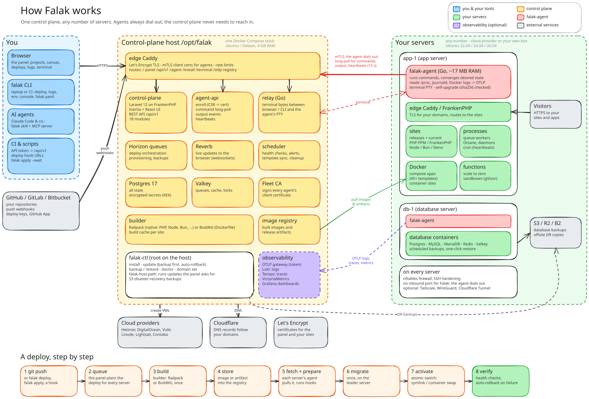

# Falak

**Falak is a self-hosted platform for running your apps on your own servers.** You install one control plane, connect
any number of Linux servers to it, and then deploy, scale, watch and debug everything from one panel, a CLI or an
API. It covers what you would otherwise put together from Laravel Forge (server provisioning), Envoyer (zero-downtime,
multi-server deploys), Coolify or Railway (Docker and native builds, compose apps, a project canvas) and Nightwatch
with a Grafana LGTM stack (APM, logs, traces, metrics, alerts).

- **Servers:** provisioned from a cloud provider (Hetzner, DigitalOcean, Vultr, Linode, AWS Lightsail, Contabo) or any
  Ubuntu 22.04–26.04 box with one install command. Falak sets up the firewall, SSH hardening and the runtimes the server
  needs.
- **Apps:** Laravel (with Octane), PHP, WordPress, Node, Bun, Deno, static sites, Dockerfiles, compose apps from 45+
  templates, and serverless-style functions that scale to zero. Push-to-deploy, health checks, automatic rollback,
  preview environments.
- **Data:** PostgreSQL, MySQL, MariaDB, Redis and Valkey containers with scheduled backups to S3-compatible storage and
  one-click restore.
- **Operations:** a web terminal and `falak console`, `.env` and secrets management, Cloudflare DNS, Tailscale,
  `falak.yaml` config as code with plans and approvals, gVisor sandboxes for untrusted code, and an Agent Skill and
  MCP server so AI agents can operate it.

## How it works



<sub>Click the diagram to see it full size. Source: [`docs/architecture.excalidraw`](docs/architecture.excalidraw).
Open it at [excalidraw.com](https://excalidraw.com) to edit it, then export it as SVG over `docs/architecture.svg`.</sub>

- **The control plane** is one Docker Compose stack on one host. Caddy terminates TLS and routes requests to the panel
  and REST API (a Laravel app on FrankenPHP), the agent API and the terminal relay. Behind them run Horizon queues,
  Reverb websockets, the scheduler, Postgres 17, Valkey, the builder and its image registry, and, with
  `--observability`, Loki, Tempo, VictoriaMetrics and Grafana.
- **Every server runs `falak-agent`**, a small Go binary (~10 MB on disk, ~17 MB RAM). The agent always dials out to
  the control plane over mTLS, using a certificate it got at enrollment, so servers need no inbound SSH. It long-polls
  for commands, streams their output back, sends a heartbeat every 15 s and forwards OTLP telemetry.
- **Commands are declarative and idempotent.** For example, `edge.caddy.apply`, `proc.apply` and `net.firewall.apply`
  carry the full desired state and the agent converges to it, so a command can safely run again after a restart. Their
  JSON Schemas in [`contracts/`](contracts) are shared by the PHP and Go code.
- **Deploys:** a push webhook (or `falak deploy`) starts a build on the builder: native via Railpack, or Docker via
  BuildKit. Each target server then fetches the build, runs migrations once on the leader, switches traffic atomically
  and health-checks it, rolling back automatically if a check fails.
- **Visitors never touch the control plane:** each server's own Caddy or FrankenPHP edge serves its sites.

---

## Quick start

### 1. Install the control plane

Use a fresh Ubuntu 22.04/24.04/26.04 or Debian 12 host with 4 GB RAM (8 GB with `--observability`) and ports 80 and
443 open. First point DNS for `falak.example.com` and `agents.falak.example.com` at it, then run:

```bash
curl -fsSL https://falak.sh/install.sh \
  | sudo bash -s -- --domain falak.example.com --email you@example.com [--observability]
```

The installer checks the host and installs Docker. It then pulls the release images, starts the stack,
requests Let's Encrypt certificates and prints the first admin's password. Open `https://falak.example.com` and sign
in. Running the installer again is safe.

### 2. Install the CLI on your laptop

On macOS or Linux (amd64/arm64), this one line installs the CLI, checks it against the release's `SHA256SUMS` and
signs you in through the browser:

```bash
curl -fsSL https://falak.sh/install-cli.sh | FALAK_URL=https://falak.example.com sh
falak whoami
```

Leave out `FALAK_URL` to only install, then run `falak login --url …` later. `falak update` updates the CLI in place.

### 3. Add a server

In the panel, open **Servers → Create** and pick a cloud provider, or pick *Custom* and run the printed one-line command
as root on a fresh Ubuntu 22.04, 24.04 or 26.04 box:

```bash
curl -fsSL https://falak.example.com/install/<one-time-token> | sh
```

The agent enrolls and the server is provisioned for its type (app, web, db, cache, worker, load balancer, builder).
`falak servers list` shows it once it is online.

### 4. Deploy something

Create a site in the panel (**Sites → Create**, or **Canvas → Create** for databases, templates and functions), or
describe it in code:

```bash
cd my-app
falak init          # writes falak.yaml from what it finds in the repo
falak plan          # what would change
falak apply --wait  # create it and stream the deployment
```

### 5. Give your AI agent the keys (optional)

```bash
falak skill install                 # teaches Claude Code, Codex & co. the CLI, falak.yaml and the API
claude mcp add falak -- falak mcp   # sandboxes as MCP tools
```

---

## Manage Falak with an AI agent

These prompts are written for Claude Code or another coding agent that has a shell. Replace the `<placeholders>` and
paste them in. The [`falak` skill](skills/falak) covers everything that goes through the panel's API (servers, sites,
agents). Control-plane host work runs as root over SSH with `falak-ctl`.

**Create a control plane**

```text
Install a Falak control plane on <user>@<host-ip> (fresh Ubuntu 24.04, sudo works). The panel domain is
<falak.example.com> and the Let's Encrypt email is <you@example.com>. [Enable --observability.]
1. Before anything else, check that <falak.example.com> and agents.<falak.example.com> resolve to <host-ip>.
   If they don't, stop and tell me which records to create.
2. Run the official installer from https://falak.sh/install.sh with those flags, then show me
   `sudo falak-ctl status` and `sudo falak-ctl doctor`.
3. Give me the panel URL and the first admin's password exactly as the installer printed it, and don't save it
   anywhere else.
4. Install the falak CLI on this machine with https://falak.sh/install-cli.sh, sign in (browser login) and run
   `falak whoami`.
```

**Update the control plane**

```text
Update the Falak control plane on <user>@<host-ip> to <vX.Y.Z | the latest release>.
1. Show the current version (`sudo falak-ctl status`) and read the release notes for every version in between on
   https://github.com/falak-sh/falak/releases. Tell me about anything breaking before going on.
2. Run the update detached so a dropped SSH session can't kill it:
   sudo bash -c "setsid nohup falak-ctl update --version <vX.Y.Z> > /tmp/falak-update.log 2>&1 < /dev/null &"
   Then follow /tmp/falak-update.log until it finishes. falak-ctl takes a backup first and rolls back by itself
   if the update fails.
3. Afterwards check that `sudo falak-ctl status` shows every service healthy and that https://<falak.example.com>/up
   returns 200. If it rolled back, show me the error from the log and find the cause before trying again.
4. Tell me how many server agents are now older than the control plane.
```

**Add a server and keep its agent current**

```text
Using the falak CLI and the Falak API (skill: falak):
1. Create a Custom server named <name> of type <app|db|…> and give me its install command. Run it as root on
   <user>@<server-ip> only if I say so.
2. Wait until the server is online and provisioned, then show `falak servers show <name>`.
3. List every server whose agent version is older than the control plane's. Upgrade them one at a time with
   POST /api/v1/servers/<id>/agent/upgrade, and wait for each one to report the new version before starting the next.
   Stop at the first failure and show me why it failed.
```

**Health check and troubleshooting**

```text
Do a read-only health check of my Falak install (skill: falak; control-plane host <user>@<host-ip>):
the control-plane version and `falak-ctl status`/`doctor`; every server (online, agent version, disk, memory); the
sites and their last deployment; failed backups; and open alerts or Insights issues. Change nothing. Give me a short
list of problems, ordered by severity, each with the command you would run to fix it, and wait for my go-ahead.
```

---

## Repository layout

| Part | What it is |
|---|---|
| `control-plane/` | Laravel 12 **modular monolith** (17 modules under `modules/`) + Inertia React TypeScript UI |
| `agent/` | Go: `falak-agent` (servers, ~10 MB, ~17 MB RAM), `falak` (CLI), `falak-builder` (build worker) |
| `packages/apm-laravel` | `falak/apm-laravel` — Nightwatch-equivalent instrumentation (Laravel 12/13) |
| `packages/apm-node` | `@othmanhaba/apm-node` — OpenTelemetry preset for Node/Bun/Deno/TypeScript apps |
| `observability/` | Loki + Tempo + Grafana + VictoriaMetrics **or** Mimir, dashboards, alert rules |
| `contracts/` | Agent protocol + telemetry contract (JSON Schemas shared by PHP and Go) |
| `sim/` | Local end-to-end simulation: control plane + 3 Ubuntu 24.04 "servers" + builder + git + LGTM |
| `docs/` | `API.md` (public REST API), `INTEGRATION-NOTES.md` (cross-module decisions, known limits) |

Architecture and module boundaries: [`ARCHITECTURE.md`](ARCHITECTURE.md).

---

## Try everything locally (simulation)

Requirements: Docker (with ~8 GB RAM for Docker), Go 1.25, `make`, `jq`, `curl`, `openssl`.

```bash
cd agent && make build && cd ..          # agent, CLI and builder binaries (mounted into the sim)
cd sim
make up                                   # builds + starts everything, waits until healthy (~1 min once images are built)
make e2e                                  # infrastructure checks (TLS, mTLS edge, observability, servers)
make e2e-deploy                           # full product flow (below), ~13 min cold, less warm; ONLY=deploy,release to iterate
```

`make e2e-deploy` drives the product **only through public surfaces** — `artisan falak:admin`, the REST
API, and the install command each server prints:

1. creates the first admin, organization and API token;
2. creates 2 app servers + 1 database server via the API, runs their install commands, and waits for
   **real provisioning** on Ubuntu 24.04 (FrankenPHP, PHP 8.4, Node, PostgreSQL, nftables firewall, SSH hardening);
3. connects a git server, creates a Laravel 13 site on both app servers (app-1 = leader);
4. deploys it: one native build → fetch + prepare on both → migrations on the leader only → activation →
   health checks; then a second commit (zero-downtime), a rollback, and a broken release that must be
   **rolled back automatically**;
5. serves a Laravel site through **Octane** (FrankenPHP worker mode behind the edge): the placeholder stays up until
   the first deploy, a redeploy and switching Octane off happen with zero failed requests;
6. deploys a Bun + Hono **TypeScript** site (runtime installed on demand, supervised web process);
7. checks observability: APM traces in Tempo, the demo exception grouped into an Insights issue,
   deployment lifecycle events in Loki.

Useful while it runs:

| | |
|---|---|
| Control plane UI | `https://localhost:8443` (trust `sim/.data/edge-root.crt`, created by `make ca`) — log in as `admin@falak.test` after setting a password: `cd sim && docker compose -p falak-sim --env-file sim.env --env-file .data/secrets.env exec control-plane php artisan falak:admin admin@falak.test --reset-password --password='choose-one'` |
| Grafana | `http://localhost:13000` (admin / admin) |
| Logs | `make logs` · `make shell` |
| Reset | `make reset` (wipes all volumes and generated secrets, keeps the package/image/download caches) · `make reset-all` (also wipes the caches) |
| Timings | each E2E stage prints its duration; summary table at the end, history in `sim/.data/e2e-timings.tsv` |

Ports differ from the defaults (13000, 14318, 8443, …) to avoid clashing with other stacks; see `sim/sim.env`.

---

## Run the tests

```bash
# Control plane (unit, feature, architecture/boundary tests) + quality gates
cd control-plane
composer install && bun install
cp .env.example .env && php artisan key:generate
./vendor/bin/pest
../tools/fetch-templates.sh   # the template catalog (github.com/falak-sh/templates) for a local panel; tests don't need it
vendor/bin/pint --test && bun run types && bun run lint:check && bun run format:check && bun run build

# Agent, CLI, builder
cd ../agent && go vet ./... && go test -race ./... && make build

# APM packages
cd ../packages/apm-laravel && composer install && vendor/bin/pest
cd ../apm-node && bun install && bun run typecheck && bun test

# Observability stack smoke test (both metrics backends)
cd ../../observability && ./smoke-test.sh --stack all
```

CI runs the same in `.github/workflows/` (control-plane, agent, packages with a Laravel 12/13 matrix).

---

## Use it

### First run
```bash
php artisan migrate --force
php artisan falak:admin you@example.com --organization="Acme" --token=cli   # prints password + API token
php artisan falak:admin you@example.com --reset-password                    # lost password
```
Then open the UI, or use the CLI / API.

### Add a server
UI: **Servers → Create** (Hetzner, DigitalOcean, Vultr, Linode, AWS Lightsail, or *Custom*).
For *Custom*, run the printed one-line install command as root on a fresh Ubuntu 22.04, 24.04 or 26.04 box. The agent
enrolls over mTLS, then the server is provisioned automatically for its type (app, web, db, cache,
worker, load balancer, builder).

### Create and deploy a site
UI: **Sites → Create** — pick server(s) (first = leader for migrations), framework preset
(Laravel, Symfony, Statamic, WordPress, PHP, Next, Nuxt, Node, static, Docker), runtime
(FrankenPHP default, php-fpm, Node, Bun, Deno, static, Docker), repository and branch.
Then **Deploy**, or enable push-to-deploy, or call the deploy hook URL from CI.
Laravel sites can switch on **Octane** under Settings → Laravel (FrankenPHP worker mode on FrankenPHP servers, Swoole or
RoadRunner on PHP-FPM): Falak picks a free port per server, and Caddy serves `public/` files itself and proxies the rest
to Octane once it answers; deploys restart Octane while Caddy holds requests.

### Functions
**Canvas → Create → Function**: write a function in Falak's editor (Bun, Node.js, Deno, Python or Go; one file or a
folder tree; drafts, versions, one-click rollback) and deploy it in seconds, with no repository. It gets a URL like
any service, reads variables and database references, and **scales to zero** when idle: the server's function
gateway starts it on the first request and adds instances under load. Details: [`docs/FUNCTIONS.md`](docs/FUNCTIONS.md).

### CLI (on your own machine)
`falak` controls a Falak install from a developer laptop or CI: deploys, rollbacks, env files, logs, SSH. Install it
as shown in [Quick start](#2-install-the-cli-on-your-laptop); `FALAK_VERSION=vX.Y.Z` pins a version and `FALAK_INSTALL_DIR`
changes the target.

`falak login --url https://falak.example.com` signs in through the browser: it shows a code, opens the panel's
approval page (sign in there as usual, confirm your password and 2FA code, check the code matches, approve) and
receives a token named "CLI — <your host>" that works in the organization you picked, with your role's permissions,
and expires after 90 days without use (and a year after the login at most). `--no-browser` prints the link instead (over SSH, open it on any device).
Scripts and CI can still use an API token from **Settings → API tokens** (`--token`, `--token-stdin`, or piped in
without a terminal; `FALAK_TOKEN` in CI). The token is checked, then stored in
`~/Library/Application Support/falak/credentials.json` (macOS) or `~/.config/falak/credentials.json` (Linux), mode
0600. `falak whoami` shows who you are; `falak logout` forgets the token and revokes it on the server when a browser
login created it (a token you pasted in is kept, since it may be used elsewhere), and revoking it in the panel cuts
the CLI off. `falak-ctl` is different: it is the server admin
tool that `install.sh` puts on the control-plane host.
```bash
falak login --url https://falak.example.com          # or FALAK_URL / FALAK_TOKEN in CI
falak servers list
falak servers stack app-1 --php 8.4 --node 22    # add runtimes to a server created without them (re-provisions it)
falak sites list
falak deploy shop --wait                            # streams output; exit code 3 if the deploy fails
falak releases shop
falak rollback shop --wait
falak env pull shop > .env.production && falak env push shop < .env.production
falak logs shop --follow
falak ssh app-1                                     # OpenSSH to a server (port 22, your key)
falak console shop                                  # shell where the site runs: its container, or its release dir as the site user
falak console shop --service worker                 # a compose site's service
falak console --db shop-db                          # shell in a database container
falak console --host app-1                          # server shell without SSH (root; --user NAME)

# Functions
falak fn list
falak fn pull hooks ./hooks                         # code + .falak-function.json
falak fn deploy hooks ./hooks -m "Add /health" --wait   # exit 4 if someone deployed after your pull (--force)
falak fn versions hooks && falak fn rollback hooks v3 --wait
falak fn run hooks "Nightly cleanup"                # run a schedule now, streams its output
falak fn invoke hooks /hello/ada -H 'X-Falak-Key: …'
falak fn logs hooks --follow

# Database containers
falak db list
falak db delete shop --confirm shop                 # the data volume stays; add --delete-volume to remove it too

# Secrets, for ${{ secrets.NAME }} (the value comes from a hidden prompt or stdin, never an argument)
falak secret set STRIPE_SECRET -p shop              # project secret; -e staging for one environment
op read op://vault/stripe/key | falak secret set STRIPE_SECRET -p shop
falak secret set --from-env .env.production -p shop # every KEY=VALUE line
falak secret list -p shop                           # names and versions, never values
falak secret delete STRIPE_SECRET -p shop --yes

# Update the CLI itself (checksum verified against the release's SHA256SUMS)
falak update                                        # latest release; --check only reports, --version vX.Y.Z pins

# Config as code (falak.yaml)
falak init                                          # writes falak.yaml from the code; --stdout, --json, --full, --yes
falak init --dockerfile                             # Go, Python, Ruby, Rust, Java: also a starter Dockerfile
falak validate                                      # offline: schema, overrides, references; exit 5 if invalid
falak plan                                          # + create, ~ update, - delete, ! risky (with the reason)
falak apply --wait                                  # applies, then streams the deployments; exit 6 if it waits for an approval
falak apply --wait --approve                        # shows the risky changes and approves them (if you may), then waits
falak runs && falak runs show 01j…                  # runs, newest first; a run's plan, approval and deployments
falak approve 01j… --comment "checked"              # or: falak reject 01j… --comment "not today"
falak drift -e production --check                   # exit 7 if the environment drifted from its last applied file
falak config unmanaged                              # what runs detached (kept, no longer managed)
falak config source set --repo acme/shop --connection 01j… --enable   # turn it on (or --disable); `show` prints it
falak config source set --allow-server app-1        # admins: a new project's file may place units there
falak init --update                                 # a diff of what the code adds to falak.yaml; --write applies it
falak config export shop -e production -o falak.yaml
```
`falak init` reads the repository the way the builder does (`builder.Detect`, a Dockerfile's `EXPOSE`, a compose file
that builds the code, `.env.example`, package and dependency files, workspaces) and writes each value with the reason
it was chosen; versions come only from the repository. Secrets (by name, or by a value that looks like a credential)
become `${{ secrets.NAME }}` references and are never printed (secret keys left empty in the example are written
commented out, as optional; Laravel's `APP_KEY` is left to Falak, which generates it for a native Laravel unit; a Laravel Dockerfile or compose
app gets `APP_KEY: ${{ secrets.APP_KEY }}`, a secret to create from `php artisan key:generate --show`); databases and Redis become units wired with
`${{ db.DATABASE_URL }}`-style references; local development values are left out. It reads and writes nothing through
symlinks that leave the repository, and never overwrites a file without `--force`. Logged in, it asks for the project,
environments, servers, a domain and previews; it links the repository (`.falak/project.json`) only to a project you
pick or pass with `-p`. Not linked, it writes no `environments` (production deploys from the default branch) and a
comment showing how to bind branches; environments the file declares are created by a push to production's branch.
`init --update` only adds: everything you wrote (keys, comments, order) stays, a renamed unit keeps its name, and a
value the code now says otherwise is flagged with a comment and a note. `apply --wait` gives up after `--timeout` (30m;
the run goes on). `approve` and `apply --approve` ask before approving (`--yes` in scripts), and ask again when the
plan changed since it was shown.
`plan`, `apply`, `runs`, `drift` and `config export` find the project with `-p` (id or name), then `FALAK_PROJECT`, then
that file; the environment with `-e`, else the one whose `branch` is the current git branch (production for a file
without environments, and for `drift`). A plan for an environment the project doesn't have yet is shown as a preview. `--json` prints the API's data as is.
The guide to the file, every field, approvals, drift and the security model: [`docs/CONFIG_AS_CODE.md`](docs/CONFIG_AS_CODE.md)
(schema: `contracts/config/v1.schema.json`; design notes: [`docs/plans/CONFIG_AS_CODE.md`](docs/plans/CONFIG_AS_CODE.md)).

### API
Sanctum bearer tokens scoped to one organization. Endpoints and payloads: [`docs/API.md`](docs/API.md).

### AI agents
An Agent Skill ([`skills/falak`](skills/falak)) teaches Claude Code, Codex and other `SKILL.md` agents to operate
Falak through the CLI, `falak.yaml` and the API, and to ask before destructive actions. `falak skill install` writes
it to `~/.claude/skills/falak` (`--project`, `--dir`). Install and least-privilege tokens: [`docs/AI_SKILL.md`](docs/AI_SKILL.md).

### Sandboxes
Disposable Linux machines on your servers for code you don't trust (an AI agent without permission prompts, a script
from the internet), isolated with gVisor: root inside, nothing reaches the server, your sites or your network. They
start in seconds and have a time limit. `falak sandbox create|exec|cp|ssh|kill`, the API, and an MCP server for
agents: `claude mcp add falak -- falak mcp`. Guide: [`docs/SANDBOXES.md`](docs/SANDBOXES.md).

### Cloudflare
Connect a Cloudflare token in **Settings → Integrations → Cloudflare** and Falak manages the DNS of your zones:
records follow your domains, new services get names under your zone, and services work behind the orange cloud
(DDoS protection, edge cache, real visitor IPs). Free plan. Setup and details: [`docs/CLOUDFLARE.md`](docs/CLOUDFLARE.md).

### Instrument your apps (APM)
- Laravel: require `falak/apm-laravel` — auto-discovered; sends requests, queries, jobs, mail,
  notifications, cache, commands, scheduled tasks, outgoing HTTP, exceptions and logs to the local agent.
- Node/Bun/Deno: `import '@othmanhaba/apm-node/register'` (see `packages/apm-node/README.md`).

Issues, thresholds and missed scheduled runs appear under **Insights**; traces, logs and metrics in
Grafana (dashboards are provisioned per organization).

---

## Operating the control plane

Full guide (requirements, DNS, upgrade, backup/restore, uninstall, troubleshooting, releasing):
[`docs/INSTALL.md`](docs/INSTALL.md). `https://falak.sh/install.sh` redirects to
[`deploy/install.sh`](deploy/install.sh) on `main`. Day-2 work on the host uses `falak-ctl` as root:

```bash
falak-ctl status                    # services, versions, health
falak-ctl update [--version vX.Y.Z] # backup first, automatic rollback if the update fails (or Update in the panel)
falak-ctl backup && falak-ctl restore <file>   # database, storage, Fleet CA, .env
falak-ctl doctor                    # preflight + live checks
falak-ctl logs [service]
falak-ctl domain set <domain>
falak-ctl admin reset-password <email>
```

Server agents are updated separately: **Servers → Update all agents**, or
`POST /api/v1/servers/{server}/agent/upgrade` for one server.

Known limits and deferred items are listed in [`docs/INTEGRATION-NOTES.md`](docs/INTEGRATION-NOTES.md).

## License

Falak is licensed under the [Apache License 2.0](LICENSE).
